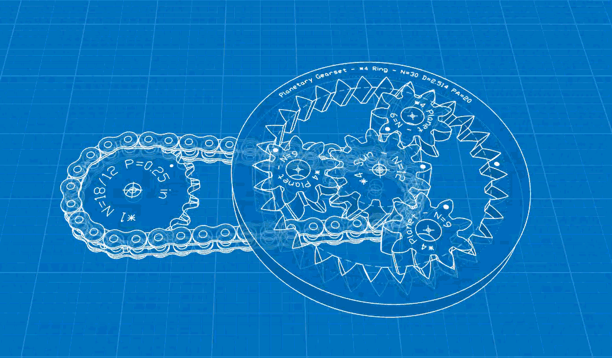

Welcome to my Engineering Portfolio! I'm a senior Engineering major at Harvey Mudd with an emphasis on mechatronics, mechanical design, and a heavy interest in biomimetics. I've been a clinic engineer at AirMyne where I did research regarding interfacial structure design to facilitate the absorption rate of CO2 in the atmosphere. I'm currently doing fluid dynamics research regarding fin motion at the Harvey Mudd FILM Lab and a mechatronics engineer under Blue Origin. In my free time, I could be working on a variety of personal mechanical/microcontroller projects, creating art, playing videogames, or rock climbing. Stay curious!

{width="600px" fig-align="center"}